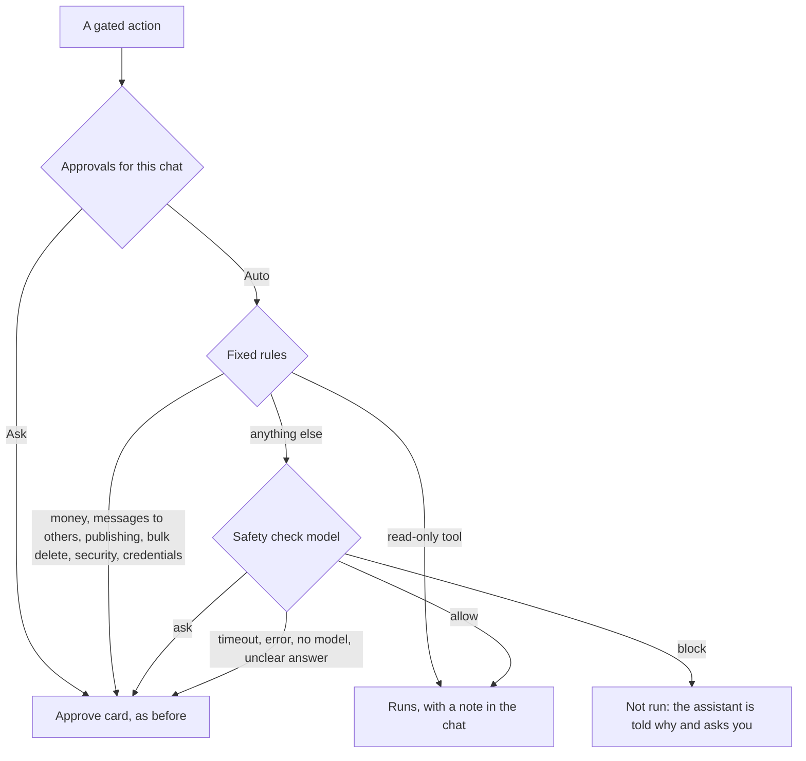

# Auto mode

Some actions wait for your OK before they run: an Approve card in the chat.
**Approvals** decides who gives that OK.

- **Ask** (the default): every gated action shows its Approve card, as it always has.
- **Auto**: a safety check decides each gated action instead. Routine actions
  that are clearly what you asked for go ahead without a card. Risky ones still
  ask you, or are blocked, and the reason is shown.

Set the default in **Settings > AI > Approvals**. Each chat can override it
with the **Ask / Auto** chip next to the message box: one click switches this
chat to the other mode, a second click goes back to your default.

## What it covers

| Gate | In Ask | In Auto |
|---|---|---|
| Gmail and Google Calendar writes (send, reply, archive, delete, mark read, events on a Google calendar) | Approve card | Checked; allowed ones run, the rest show the card |
| Mod tools that ask first or control devices | Approve card | Checked the same way |
| Sending into or stopping your OpenCode chat | Approve card | Checked the same way |
| Screen control (click, type, screenshot, open apps on a machine) | Approve link, then a 15 minute grant | Each action is checked on its own; no grant is handed out |
| A plan the assistant proposes (`propose_plan`) | Plan card | Allowed: approved, and the work starts in a new turn as after your click. Otherwise the card waits |
| A coding run's plan (`claude_code` plan) | Approve link | Allowed: approved, and the run starts once the turn ends. Otherwise the link stays |

Scheduled tasks, the mail listener and a mod's own agent runs always ask,
whatever the setting: nobody is watching them live.

## What Auto never approves by itself

These always show the card, whatever the safety check would say. No model is
asked; a fixed rule decides:

- spending money or buying anything
- email or messages to anyone other than you (your own mailbox addresses count as you)
- publishing or posting
- deleting data in bulk (more than one item, or "all")
- changing sign-in, permissions, sharing or other security settings
- anything carrying passwords, keys, tokens or other credentials

A tool its own metadata marks read-only is always allowed.

## How a decision is made

The safety check model gets your latest requests in the chat, the tool, what
it would do, its flags (read-only, outward-facing, destructive, controls
devices) and its arguments with secrets redacted. It answers with one line of
JSON: allow, ask or block, and a reason. Identical decisions are reused within
a turn.

**Which model:** pick one under **Safety check model**. Left on Automatic, it
is your Utility model (or your Default Chat model when Utility is unset) if
that is local or a subscription, else the first local model. It never falls
back to a model that is billed per use; pick one yourself if you want that.
With no model available, Auto asks you about everything a fixed rule does not
allow.

## What you see

- An allowed action runs without a card and leaves a note under its step:
  "Auto-approved: <action> (<reason>)". Click it for how it was decided.
- An action that still asks shows the usual card, with an "Auto mode" row
  saying why.
- A blocked action does not run. The assistant gets a result saying auto mode
  blocked it and why, and tells you instead of trying another way.
- **Settings > AI > Approvals > Auto mode log** lists every decision: when,
  the action, allowed / asked / blocked, the reason, and whether a rule or the
  model decided. Arguments are stored with secrets redacted
  (`DATA_DIR/auto_mode_log.jsonl`).

## Safety

Only your own page changes Approvals (`/api/auto_mode`). The assistant cannot:
`app_api` refuses `/api/auto_mode`, the generic preferences API refuses the
`approvals_mode` and `auto_mode_model` keys, and API tokens are refused.
